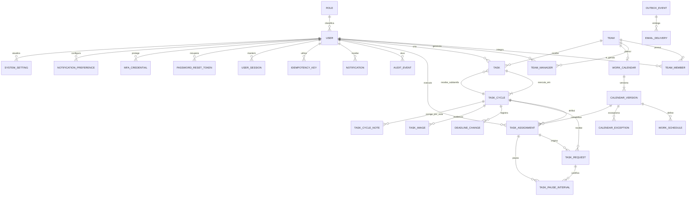

# ERD — Camada de persistência

Diagrama derivado de `backend/prisma/schema.prisma` para a Fase 1. Campos e constraints detalhados permanecem no schema e nas migrações SQL.

## Regras estruturais principais

- Uma tarefa possui vários ciclos históricos, mas apenas um ciclo aberto.
- Um ciclo possui várias atribuições históricas, mas apenas uma atribuição atual.
- Subtarefas pertencem ao ciclo da tarefa principal e são limitadas a uma camada.
- Solicitações referenciam uma atribuição pertencente ao mesmo ciclo.
- Uma pausa aberta e uma solicitação pendente por tipo são únicas por atribuição.
- Calendários pertencem a equipes e suas versões publicadas não se sobrepõem.
- Auditoria, alterações de prazo e notas de ciclo são append-only.

