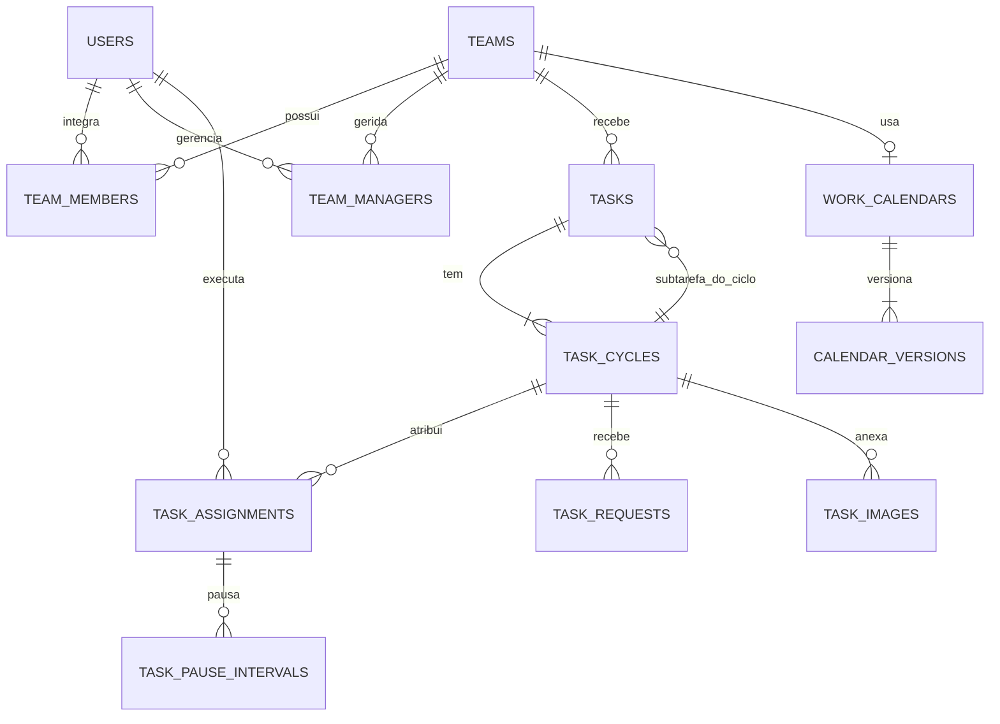

# SDD 03 — Modelo lógico de dados (MySQL + Prisma)

## Convenções
- MySQL 8+ InnoDB, `utf8mb4`, collation consistente; IDs `CHAR(36)` ou `VARCHAR(36)` UUID; número público sequencial `BIGINT UNSIGNED` único.
- `DATETIME(3)` em UTC na aplicação (MySQL DATETIME não carrega timezone). Todas as datas de eventos imutáveis quando históricas.
- `createdAt`, `updatedAt`, `version` nos agregados mutáveis. FK com `RESTRICT`/`NO ACTION` em históricos; exclusão lógica de usuários/tarefas/imagens.
- `@@index` para filtros; SQL complementar versionado para índices em colunas geradas, triggers quando imprescindíveis, e verificações não expressáveis em Prisma.
- Nunca confiar em `@updatedAt` para controle de concorrência: usar `version` incremental e CAS transacional.

## Entidades e campos mínimos
| Tabela | Campos essenciais | Restrições / observações |
|---|---|---|
| `users` | id, name, emailNormalized, passwordHash, roleId, isActive, createdAt | email único; senha somente hash |
| `roles` | id, code, label | code único: ADMIN_MASTER, SECRETARY, MANAGER, TECHNICIAN |
| `teams` | id, name, isActive, calendarId | equipe inativada não recebe novas atribuições |
| `team_members` | id, teamId, userId, joinedAt, leftAt | histórico de filiação; evitar vínculo ativo duplicado |
| `team_managers` | id, teamId, userId, assignedAt, endedAt | histórico de gestão e escopo atual |
| `tasks` | id, publicNumber, teamId, createdById, parentCycleId?, currentCycleId?, createdAt | identidade; parentCycleId apenas subtarefa; impedir 2º nível |
| `task_cycles` | id, taskId, cycleNumber, title, description, priority, status, deadlineAt?, version, openedAt, closedAt?, completionText? | `UNIQUE(taskId,cycleNumber)`; um ciclo ativo |
| `task_assignments` | id, cycleId, userId, assignedById, assignedAt, acceptedAt?, endedAt?, endReason?, calendarVersionId | no máximo uma atribuição atual; histórico imutável após encerramento |
| `task_requests` | id, cycleId, assignmentId, type, status, reason, proposedDeadlineAt?, decidedById?, decidedAt?, decisionReason? | solicitação vinculada a atribuição e ciclo válidos |
| `task_pause_intervals` | id, assignmentId, requestId, startedAt, endedAt? | não sobrepor; uma pausa aberta por atribuição |
| `deadline_changes` | id, cycleId, oldDeadlineAt, newDeadlineAt, reason, changedById, createdAt | append-only; motivo obrigatório |
| `task_images` | id, cycleId, uploadedById, storageKey, mimeType, sizeBytes, checksum, createdAt, deletedAt? | só imagens; contagem sob lock; storage privado |
| `work_calendars` | id, teamId, timezone, activeVersionId | timezone IANA (ex.: America/Cuiaba) |
| `calendar_versions` | id, calendarId, versionNumber, effectiveFrom, effectiveTo?, createdById, createdAt | versões publicadas imutáveis; sem sobreposição de vigência |
| `work_schedules` | id, calendarVersionId, weekday, startMinute, endMinute | intervalos locais [início,fim), sem sobreposição |
| `calendar_exceptions` | id, calendarVersionId, localDate, type, startMinute?, endMinute? | feriados, expediente excepcional, precedência definida |
| `audit_events` | id, actorId?, entityType, entityId, action, beforeJson?, afterJson?, reason?, correlationId, createdAt | append-only, sem dados sensíveis |
| `notifications` | id, userId, type, title, body, entityType, entityId, readAt?, createdAt | acesso por destinatário |
| `outbox_events` | id, eventType, payloadJson, dedupeKey, status, attempts, nextAttemptAt, createdAt | UNIQUE(dedupeKey), inserido com transação de negócio |
| `email_deliveries` | id, outboxEventId, recipient, status, attemptCount, lastError?, sentAt? | tentativas e resultado |
| `idempotency_keys` | id, actorId, key, requestHash, responseStatus?, responseBodyJson?, state, expiresAt | UNIQUE(actorId,key); mesmo key+hash retorna resultado anterior |
| `user_sessions` | id, userId, refreshTokenHash, createdAt, expiresAt, revokedAt? | nunca guardar refresh token puro |

**Complementos recomendados:** `task_cycle_notes` (correções administrativas após conclusão), `system_settings` (limites e lembretes), `password_reset_tokens` e `mfa_credentials` (segurança de ADMIN MASTER), `notification_preferences` (opcional). Esses componentes são explicitamente planejados e não devem ser omitidos se o requisito correspondente for implementado.

## Relações críticas
`tasks 1:N task_cycles`; `task_cycles 1:N task_assignments`, `task_requests`, `task_images`, `deadline_changes`; `tasks.parentCycleId -> task_cycles.id` para subtarefas; `task_requests.assignmentId -> task_assignments.id`; `team_members` e `team_managers` conectam usuários e equipes com validade temporal.

**Integridade cruzada:** garantir que `tasks.currentCycleId` aponte para um ciclo da mesma tarefa; que `task_requests.cycleId` coincida com `task_assignments.cycleId`; que uma subtarefa não aponte para ciclo de outra subtarefa. Usar FKs compostas quando possível, além de validação transacional. Referências circulares de ciclo atual exigem migrações ordenadas e atualização transacional.

## Índices e unicidade de ativos
MySQL não tem índices parciais. Para impor um ciclo aberto por tarefa: coluna gerada armazenada `activeTaskKey = CASE WHEN closedAt IS NULL THEN taskId ELSE NULL END`, com UNIQUE; para atribuição atual: `activeCycleKey = CASE WHEN endedAt IS NULL THEN cycleId ELSE NULL END`, com UNIQUE; para pausa aberta, `activeAssignmentKey` equivalente; para pedido pendente, `pendingRequestKey` composto/gerado por `assignmentId + type` quando status pendente. A implementação exata deverá ser validada no MySQL e registrada em migração SQL; Prisma pode não representar diretamente tais índices. **Não confundir ciclo aberto com status PENDING:** ciclo aberto pode estar em qualquer estado não terminal.

## Consistência e retenção
- Uma tarefa pode existir sem atribuição em PENDING; após atribuição há exatamente uma atribuição atual enquanto aguardando aceite ou em andamento, salvo fluxo de transição atômico.
- Nunca apagar ciclos anteriores nem reativar subtarefas históricas.
- Registrar motivo, ator e timestamps em mudanças críticas.
- Políticas de retenção e LGPD devem ser definidas pela instituição antes de produção.

## ERD resumido

## Limites do artefato
Este SDD é o contrato de modelagem; o `schema.prisma` **não é incluído como código definitivo** nesta fase de arquitetura. O Codex deverá gerá-lo e validar `prisma validate`, migrações e testes reais conforme SDD 09.
